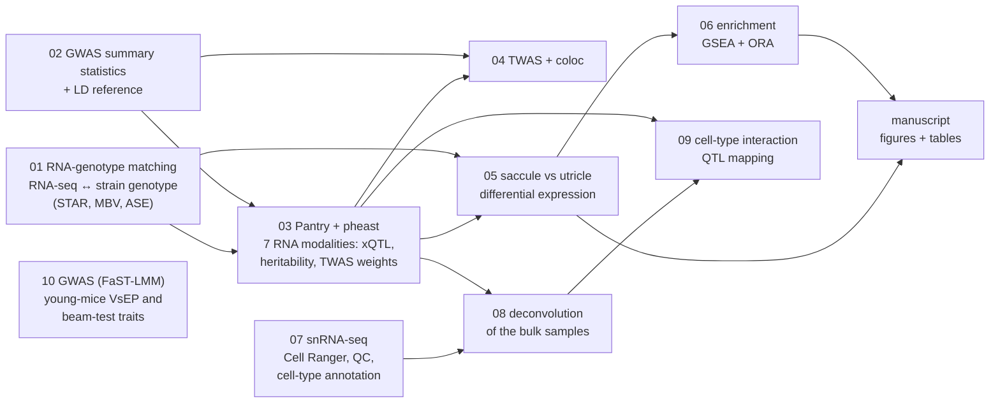

# The genetics of functional decline in the aging vestibular system

**Bulk RNA-seq** of the two otolith organs, saccule and utricle, of BXD recombinant inbred mice at 8 and 22 weeks,
matched to strain genotypes: multimodal xQTL mapping across seven RNA modalities (Pantry), TWAS and colocalization
with mouse vestibular GWAS traits, and saccule-vs-utricle differential expression and pathway enrichment.

**Single-nucleus RNA-seq** of both organs: cell-type annotation, cell-type deconvolution of the bulk samples, and
cell-type-aware (interaction) QTL mapping.

The whole analysis is a set of Snakemake workflows, one per analysis, run in order by the main `Snakefile`.

> Code for a manuscript in preparation. Results, figures and the report-building scripts will be added after
> publication.

## Workflow

Each box is one folder in `analyses/` with its own Snakefile.



## Repository layout

```
Snakefile            main workflow: the analyses in order, then the manuscript outputs
config/config.yaml   all shared paths and parameters
profiles/slurm/      Snakemake Slurm profile (template)
run_pipeline.slurm   Slurm controller job; its arguments go to snakemake
envs/                conda environments (one YAML file per environment)
analyses/
  01_rna_genotype_matching/    RNA-seq to strain genotype matching (STAR, RSEM, MBV, ASEReadCounter), Pantry inputs
  02_gwas_sumstats/            GWAS summary statistics (LDSC format) and BXD LD reference for TWAS
  03_pantry/                   Pantry phenotyping (7 RNA modalities) + pheast (xQTL, heritability, TWAS weights)
  04_twas/                     FUSION TWAS + coloc with the six GWAS traits
  05_dge/                      saccule vs utricle and age differential expression (DESeq2)
  06_enrichment/               GSEA and over-representation analysis of the DGE results
  07_single_cell_rna/          snRNA-seq: Cell Ranger, QC (SoupX, doublets), cell-type annotation, per-organ analysis
  08_deconvolution/            bulk deconvolution with the snRNA-seq reference (Bisque, MuSiC, ssGSEA)
  09_interaction_qtl_mapping/  cell-type interaction QTLs (tensorQTL)
  10_gwas/                     GWAS of the young-mice VsEP and beam-test traits (FaST-LMM)
manuscript/          paper figures, supplementary tables and reports (added after publication)
data/                raw inputs (not in the repository; see data/README.md)
resources/           shared genome and annotation (not in the repository; see resources/README.md)
logs/                run logs
```

Each analysis folder holds its `Snakefile`, `scripts/` and a `README.md` describing its steps and outputs. Inputs,
intermediate files, results, figures and reports are not in the repository; the README.md in each of those folders
describes what goes there. Pantry (`analyses/03_pantry`) keeps its own layout inside `phenotyping/` and `pheast/`.

Groups used throughout: `saccule_w8`, `saccule_w22`, `utricle_w8`, `utricle_w22` (organ × age).

## Data

The raw data (bulk and single-nucleus RNA-seq FASTQs, BXD genotypes, GWAS results and phenotypes) are not included in
this repository. `data/README.md` lists the expected files and `config/config.yaml` (`data:`) where they are read from.

## Author

Mehdi Esmaeili-Fard (mehdi.esmaeilifard@gmail.com).
